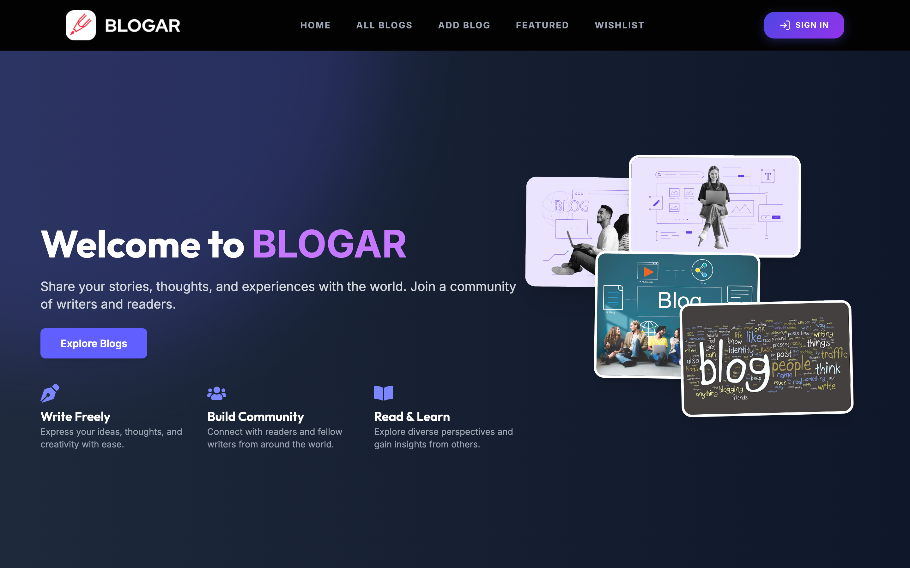
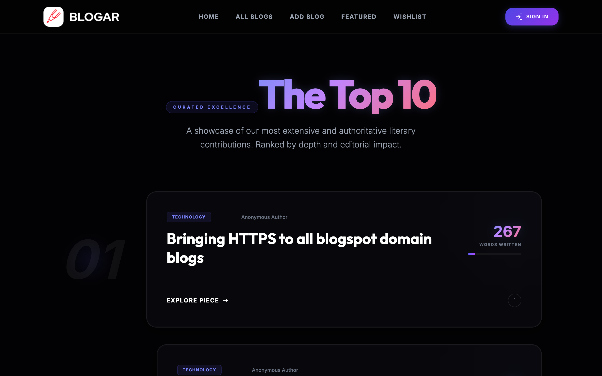

# Blogar

**Full-Stack Blogging Platform — Client Application**


Blogar is a modern React blogging frontend paired with a Node.js/Express/MongoDB backend—enabling readers to browse recent, trending, and featured articles, search or filter stories, save posts to a personal wishlist, and write, update, or discuss articles behind Firebase authentication.

- **Live Website:** [https://log-web-34782.web.app/](https://log-web-34782.web.app/)
- **Companion Server Repo:** [IFTI-KAR/blog-server-side](https://github.com/IFTI-KAR/blog-server-side)

---

## Screenshots

| Editorial Home | Featured Blogs Table |
| :---: | :---: |
|  |  |

---

## Core Features

- **Editorial Discovery Feed**: Home page featuring interactive hero motion (`three`, `postprocessing`, `motion`, `lottie-react`), recent stories (`RecentBlog`), trending tags (`TrendingTags`), feature highlights, and newsletter subscription.
- **Featured Articles Table**: Powered by `@tanstack/react-table` for clean ranking and inspection of top stories.
- **Full Blog CRUD (Authenticated)**: Protected routes (`PrivateRoute`) for publishing new blogs (`/add-blog`), editing authored posts (`/blogs/update/:id`), reading full blog details (`/blogs/:id`), and managing a saved wishlist (`/wishlist`).
- **Category Filtering & Search**: Browse stories across `Allblogs` with category filters and instant feedback via `react-hot-toast`, `react-toastify`, and `sweetalert2`.

---

## Tech Stack

| Category | Technologies |
| :--- | :--- |
| **Core UI** | React 19.1, Vite 7.0, React Router 7.6, Axios 1.10 |
| **Styling & Motion** | Tailwind CSS 4.1, DaisyUI 5.0, Motion 12, Lottie React, Three.js + Postprocessing |
| **Tables & UX** | TanStack Table 8.21, SweetAlert2, React Hot Toast, React Toastify, React Icons |
| **Auth & Hosting** | Firebase Auth (`firebase` v11), Firebase Hosting (`firebase.json`) |

---

## Backend API Endpoints Consumed

| Method | Endpoint | Access | Description |
| :--- | :--- | :--- | :--- |
| `GET` | `/blogs` | Public | Fetch published blogs |
| `GET` | `/blogs/:id` | Authenticated | Fetch single blog details |
| `POST` | `/blogs` | Authenticated | Publish a new blog post |
| `PATCH` | `/blogs/:id` | Authenticated | Update an authored blog post |
| `DELETE` | `/blogs/:id` | Authenticated | Delete an authored blog post |
| `GET` | `/wishlist` | Authenticated | Fetch saved user wishlist |
| `POST` | `/wishlist` | Authenticated | Add an article to wishlist |

---

## Project Structure

```text
Blogar-a-blog-site-client/
├── src/
│   ├── assets/                          # Images & Lottie animations
│   ├── context/
│   │   ├── AuthContext/                 # Firebase auth state & token sync
│   │   └── PrivsteRoute/                # Authenticated route guard
│   ├── firebase/firebase.init.js
│   ├── layouts/Rootlayout.jsx
│   ├── pages/                           # Home, Allblogs, Featured, RecentBlog, TrendingTags, BlogDetails, Addblog, UpdateBlog, Wishlist, Faq, Login, Register
│   └── router/router.jsx
├── firebase.json
└── package.json
```

---

## Local Setup

### Prerequisites

- Node.js 18+
- Companion backend ([blog-server-side](https://github.com/IFTI-KAR/blog-server-side)) or hosted API URL

### Installation & Run

```bash
git clone https://github.com/IFTI-KAR/Blogar-a-blog-site-client.git
cd Blogar-a-blog-site-client

# Install dependencies
npm install
```

Create a `.env` file in the root directory:

```env
VITE_apiKey=your_firebase_api_key
VITE_authDomain=your_project.firebaseapp.com
VITE_projectId=your_project_id
VITE_storageBucket=your_project.appspot.com
VITE_messagingSenderId=your_sender_id
VITE_appId=your_app_id
VITE_SERVER_URL=http://localhost:5000
```

Start Vite:

```bash
npm run dev
```
